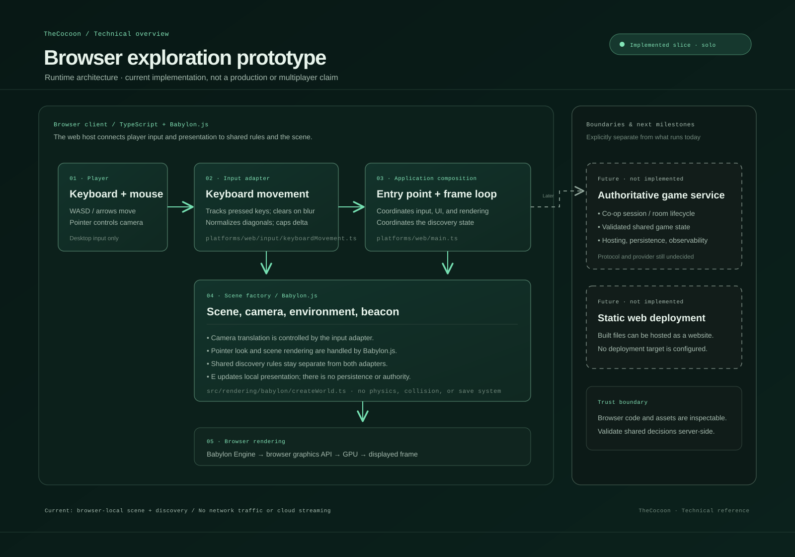

# TheCocoon

The Cocoon is a browser-first 3D exploration game in which a new Wayfinder helps Mori, a lost cocoon spirit, restore the star-notes of the silent Hearthbell. See [docs/STORY.md](docs/STORY.md) for the current story foundation; names and details remain open to player feedback.

## Quick test launch

While the local **Play web prototype** task is running in VS Code, click:

[Open TheCocoon in your browser](http://127.0.0.1:5173/)

The link opens the game when the server is available. If it is not running, start **Play web prototype** from VS Code's **Terminal → Run Task…** menu. The browser cannot start a local server by itself, so leave the task running while you play.

## Current direction

- Start with a small 3D exploration-and-discovery game.
- Support solo play and real-time cooperative multiplayer from the start.
- Add environmental puzzles, collection/extraction, and survival gradually, validating each step.
- Prioritize an early browser playable build for feedback. Broader platform support is a long-term goal, not a guarantee of one-click deployment everywhere.
- Provisional technology direction: TypeScript and Babylon.js, with WebGL 2 as the compatibility baseline and WebGPU as an optional enhancement. Confirm this during project setup.
- Cloud game streaming is not currently in scope. Online co-op will need a network service; its design and hosting are still open decisions.

See [docs/GAME_BRIEF.md](docs/GAME_BRIEF.md) for the current decisions and open questions, and [docs/PROGRESS.md](docs/PROGRESS.md) for the milestone tracker.

## Technical overview



See [docs/ARCHITECTURE.md](docs/ARCHITECTURE.md) for the current runtime flow, module responsibilities, trust boundaries, and explicitly unimplemented future services. See [docs/PLATFORMS_AND_OFFLINE.md](docs/PLATFORMS_AND_OFFLINE.md) and [platforms/README.md](platforms/README.md) for platform extension rules and offline setup.

## Project layout

```text
docs/                         Architecture, platform guidance, and project tracking
platforms/
  web/                        Browser entry point, browser input, and web presentation
  windows/                    Reserved for a future Windows desktop shell
  macos/                      Reserved for a future macOS desktop shell
  linux/                      Reserved for a future Linux desktop shell
  android/                    Reserved for a future Android shell
  ios/                         Reserved for a future iOS shell
src/
  game/                       Platform-independent rules and state
  rendering/babylon/          Babylon.js scene/rendering adapter
public/assets/                Locally stored game assets
tests/                        Automated tests
```

The OS-specific folders are documented placeholders, not native apps or promises of support. Keep common gameplay in `src/game`; add a platform implementation only after its runtime and packaging strategy have been selected. Assets belong in `public/assets` and should be stored locally rather than fetched from remote URLs at runtime.

## Run locally

On a connected machine, install the locked dependencies with `npm ci`. Start the web dev server with `npm run dev:web`, check types with `npm run typecheck`, and create a production web build with `npm run build:web`.

For offline development after the dependency packages have been cached on this machine, use `npm ci --offline` and then the same scripts. A first-time offline setup requires a pre-populated npm cache or an approved offline dependency bundle; the lockfile alone does not contain package files. See [docs/PLATFORMS_AND_OFFLINE.md](docs/PLATFORMS_AND_OFFLINE.md) before preparing a disconnected machine.

The current prototype opens with the first chapter's story. Choose **Begin the story**, then use **WASD** and the mouse to follow the path to Mori. Press **E** nearby to wake three star-lights and reveal the hilltop bell. Reaching and ringing the bell is not implemented yet. The prototype is desktop-browser and keyboard/mouse only; touch controls and online co-op are not implemented.
