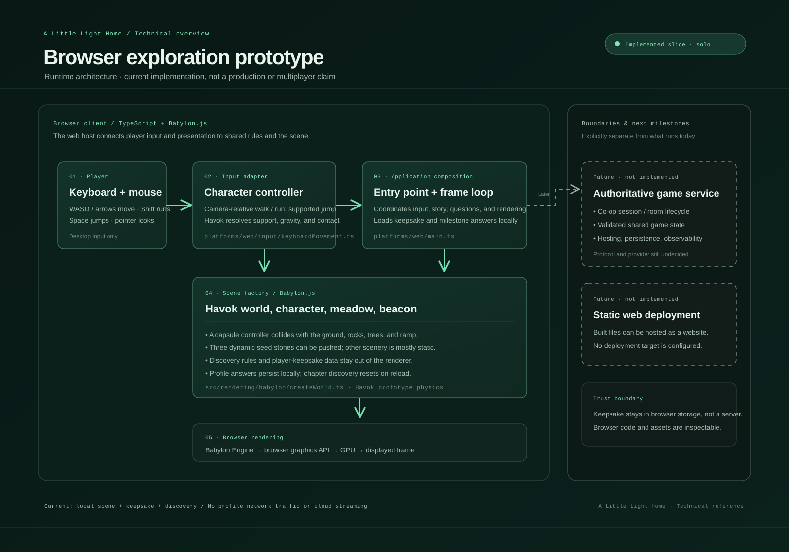

# Runtime architecture

> **Status:** architecture of the current browser prototype, not a claim that the project is production-ready. Dashed modules in the diagram are future work and are not present in the running application.

## What runs today

The prototype is a single-page browser application. Its web entry point creates the Babylon.js engine, builds one procedural scene, registers desktop keyboard movement, and coordinates a one-shot discovery transition supplied by the platform-independent game layer. A chapter-specific illustrated splash screen introduces the Wayfinder, Mori, Starwake Meadow, and the silent Hearthbell before the player chooses “Begin the story.” Greeting Mori wakes three star-lights along the path to the visible hilltop bell. At this first natural pause, an optional keepsake form can ask for a nickname and a few playful preferences. Babylon renders the scene continuously while the browser tab is active.

| Layer | Responsibility | Current implementation |
|---|---|---|
| Browser shell | Supplies the render canvas, status text, interaction hint, and controls display. | `index.html`, `platforms/web/style.css` |
| Web composition root | Checks required DOM elements, creates runtime objects, connects systems, updates discovery UI, and starts the render loop. | `platforms/web/main.ts` |
| Web input adapter | Tracks WASD/arrow keys, computes camera-relative movement, accelerates and brakes the player, integrates gravity, and supplies frame-scaled movement to Babylon's collision-aware camera. | `platforms/web/input/keyboardMovement.ts` |
| Browser keepsake | Validates an optional nickname and fixed-choice favorites; edits or removes a versioned profile stored only in this browser. | `platforms/web/playerProfile.ts`, `platforms/web/main.ts` |
| Platform-independent game rules | Owns discovery range and the one-shot discovery state transition without browser or rendering dependencies. | `src/game/discovery/discovery.ts` |
| Babylon.js renderer adapter | Creates the camera, lights, placeholder environment, beacon, and simple beacon animation. | `src/rendering/babylon/createWorld.ts` |
| Browser renderer | Uses Babylon's engine to draw the scene to the canvas through the browser's graphics stack. | `@babylonjs/core` |

## Frame and interaction flow

1. A browser key event updates the web input adapter's set of currently pressed movement keys.
2. Each render frame, the web entry point asks the adapter to move the camera using the frame's elapsed time.
3. Before rendering, the entry point calls the platform-independent game rule to check camera-to-Mori range and show the interaction hint.
4. When **E** is pressed in range, the entry point asks the game rule for a discovery state transition, then updates local story text, dims Mori, and lights the three waypoint objects and distant bell. If no keepsake exists, the player may answer optional questions or skip; saved preferences personalize the story response and waypoint-light color.
5. Babylon renders the updated scene and the browser presents the resulting frame.

Mori and the discovery state exist only in the current page runtime. Reloading resets the discovery and returns the star-lights to their inactive state, while the optional keepsake remains in browser storage. The profile button opens it for editing, and the forget action removes it. No profile data is sent to a server or shared with other players. Storage parsing, validation, save, and clear failures are shown in the keepsake form rather than silently ignored.

## Movement and physical rules

The browser prototype uses a grounded camera ellipsoid with collision-aware movement. Horizontal velocity accelerates and brakes over time; a delta-time gravity step brings the player back to the ground. The flat meadow, rounded rocks, tree trunks/canopies, bell supports, and a shallow box-mesh approach ramp are solid. Path stones remain decorative and do not trip the player. These are game-tuned scene units, not meters, and Babylon's simple camera collision solver is not a full rigid-body simulator. There is no jumping, object pushing, slope variation beyond the ramp, or terrain streaming yet.

## Design boundaries

- **Game rules stay platform-neutral.** `src/game` must not import browser APIs, OS APIs, or Babylon.js. Platform and rendering adapters may call these rules, but should not copy them.
- **Input is not gameplay authority.** The web adapter currently owns keyboard movement and velocity; Babylon applies camera collision and position updates. A future player-controller layer can replace this without making the renderer responsible for input policy.
- **The scene factory does not own the engine.** The entry point creates the engine; `createWorld` creates a scene attached to it and returns the references needed by movement and discovery.
- **Discovery is a prototype interaction, not a reusable system.** The current range check is a local three-dimensional distance check; it has no line-of-sight test, server validation, or persistence.
- **Rendering is not networking.** There is no session service, remote player, shared state, or network traffic in this build. Real-time co-op needs a separately designed session protocol and authoritative state rules.
- **A private source repository does not hide shipped browser code.** Treat browser-delivered code and assets as publicly inspectable. Do not put credentials in the client; a future service must validate important shared game-state changes on the server.

## Not yet implemented

- Online co-op, session creation/joining, remote-player replication, and authoritative validation.
- Accounts, game progression saves, analytics, moderation, or an online backend. The optional profile is browser-local and is not shared.
- Touch controls, mobile usability validation, or a supported browser/device matrix.
- Full physics, jumping, object interaction, slopes beyond the approach ramp, a player avatar, or animation.
- Static hosting, automated deployment, release operations, or cloud game streaming.
- Verified WebGL/WebGPU compatibility and measured performance targets.

The repository visibility and licensing decision should be revisited during release preparation, as tracked in [the game brief](GAME_BRIEF.md).

Platform folder ownership and disconnected-development setup are described in [the workspace platform guide](../../../docs/PLATFORMS_AND_OFFLINE.md). OS-specific folders are placeholders; there are no native apps or packaging workflows yet.

The current narrative beats, characters, tone, and playtesting questions are recorded in [STORY.md](STORY.md).

## Source map

- [Web application entry point](../platforms/web/main.ts)
- [Web keyboard movement](../platforms/web/input/keyboardMovement.ts)
- [Optional player keepsake](../platforms/web/playerProfile.ts)
- [Platform-independent discovery rules](../src/game/discovery/discovery.ts)
- [Babylon.js world and scene construction](../src/rendering/babylon/createWorld.ts)
- [Project progress](PROGRESS.md)
